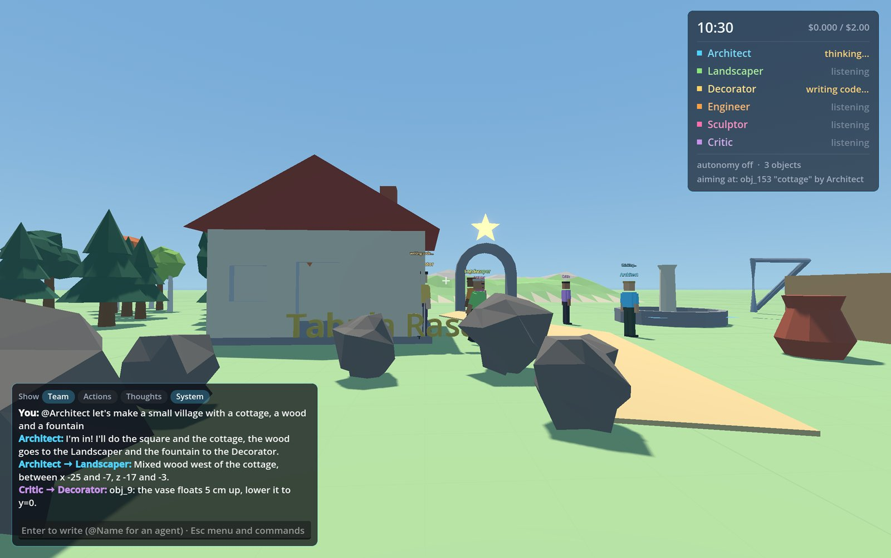
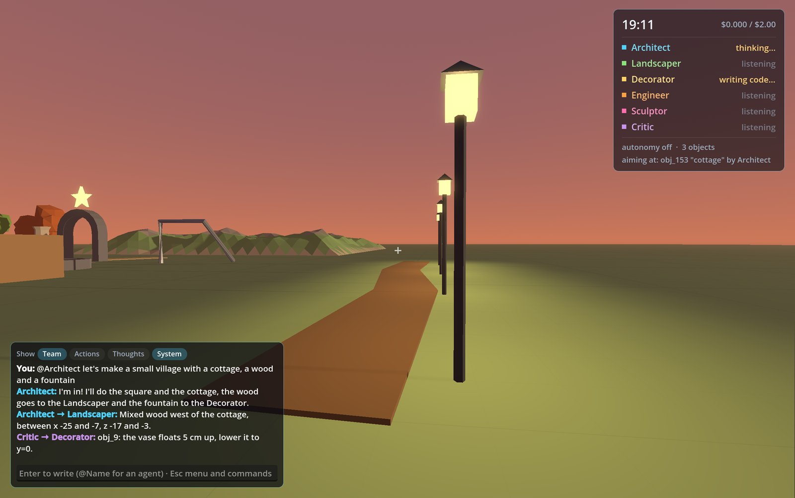
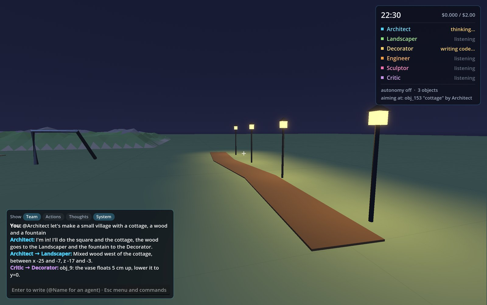
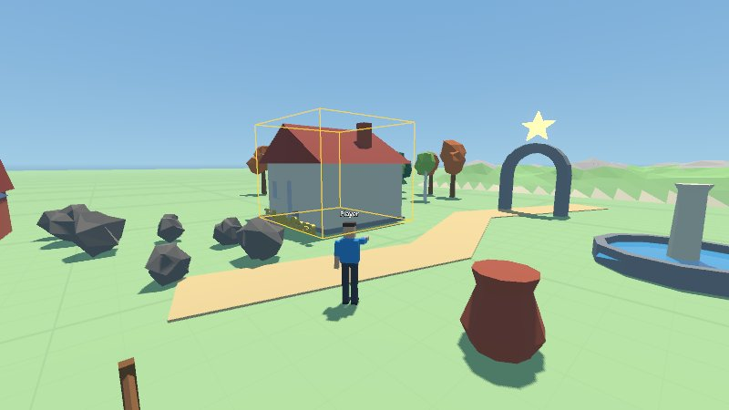

# Tabula Rasa

An empty 3D world, you and a team of AI agents (Claude). The agents see the state of the
world, talk to you and to each other, split the work and build by writing GDScript that is
compiled at runtime. You can walk around, talk to them and write code in your own console.



| Sunset | Night |
|---|---|
|  |  |
| **What an agent sees: 4-view inspection** | **The player seen by an agent (build mode)** |
|  |  |

<details><summary>Settings menu</summary>


</details>

## The team

The default roles are in `agents.json` (name, color, model, role):
- **Architect** (lead): structures, layout, planning and delegating. Uses Haiku, but switches to
  Sonnet (`model_for_player` in `agents.json`) in the turns where you write to it;
- **Landscaper**: nature at a large scale (terrain, forests, rivers, rocks);
- **Decorator**: details at human scale (furniture, lights, signs, flowers);
- **Engineer**: mechanisms, animations, physics, minigames;
- **Sculptor** (Sonnet): designs the library's models in the workshop, when teammates ask;
- **Critic** (`reviewer: true`): doesn't build. It starts on its own a few seconds after a
  teammate finishes a job (at most 3 times per message of yours), inspects it with
  measure / inspect_visual / walk_test and sends the author specific fixes.

The agents have a low-poly human body in their color: before building or changing something
they walk there (or fly, if the spot is high up) and point at it while they work; when they
talk to you they come to you and move their mouth, and they do the same with the teammate they
talk to. The agents stay where they work and only catch up with you when you get more than
~16 m away (`/follow` turns that off). During every photo all the bodies are hidden for an
instant.

In game:
- `@Name message` talks to an agent, `@all` to everyone; without a mention the lead answers.
- `/new Name: role description` creates a new agent (at most 8 in total), `/remove Name`
  removes it, `/agents` lists the team. Agents created in game are saved with the world.
- The agents talk to each other with `say` toward a teammate, who is "woken up" and answers. To
  avoid endless chatter, between two of your messages each agent can be woken up by other
  agents at most 4 times.
- Everyone sees the **shared board**: one section per agent with plan, areas and tasks.

## Vision

The agents have the `take_photo` tool: a virtual camera (`scripts/photographer.gd`, a
SubViewport that shares the world) takes an 800x450 photo from the chosen spot, or exactly
what you see (`view="player"`). The JPEG goes back to the agent as an image in the tool
result, and you see the photo in a panel at the bottom right. The agents use it to check what
they build and when you ask "look" or "what do you think?". Photos from earlier turns are
removed from the history to keep the token count down. Every image the agents look at
(photos, inspections, catalog previews) is kept in `photos/<date>/` with time, agent and kind
in the file name.

## Style

Everything the team makes follows the same style guide (STYLE section of the prompt):
faceted low-poly, solid shapes, 2-4 colors per object taken from the **shared palette**, real
proportions and an even level of detail.

- The palette is in `palette.json`, shared by every world, organized in groups (stone and
  masonry, woods, nature, water and glass, metals, fabrics and surfaces, lights) with a
  description per color. The agents extend it with `add_color`, which refuses near-duplicates
  and suggests the existing color. The names are used as `"mat"` in recipes and in
  `Shapes.material(name)`.
- `#rrggbb` colors are still allowed, but the workshop flags them. The `design_model` report
  has a **Style** section with advice (never a block): off-palette colors with the closest
  one, too many colors, shapes that are too smooth, parts thinner than 1 cm, too much detail.
- In the menu, the **Style** tab shows the palette as swatches.
- Test: `tests/styletest.tscn`.

## Models made by the agents (`Assets`)

There are no ready-made models: every object (sofa, fridge, streetlight, tree, cart…) is
designed by the team. A model is a **JSON recipe** in `models/<name>.json`: a list of Shapes kit
parts (box, cylinder, lathe, extrude, sweep, tube, roof, wall, light…), placed with
coordinates or anchored to each other, with `positions` for copies and `mirror` for symmetry.

```json
{"parts": [
  {"id": "leg", "shape": "box", "size": [0.05, 0.45, 0.05], "mat": "wood", "positions": [[0.2, 0, 0.2], [0.2, 0, -0.2]], "mirror": "x"},
  {"id": "seat", "shape": "box", "size": [0.5, 0.05, 0.5], "mat": "light_wood", "position": [0, 0.45, 0]},
  {"id": "backrest", "shape": "box", "size": [0.5, 0.45, 0.05], "mat": "wood", "anchor": {"to": "seat", "side": "top", "align": "back"}}
]}
```

- `design_model` is the **workshop**: it builds the recipe outside the world and returns 4 views
  (front, side, back 3/4, top) and a report (size, extent of every part, floating parts,
  errors). The agent fixes it and tries again until it is happy with the model.
- `save_model` puts it in the library; `search_assets`, `preview_assets` and `spawn_asset`
  (with `anchor` too) use it like any other model, and in scripts
  `Assets.instance("name", true)`. Saving under the same name also updates the copies already
  in the world. `get_model` reads a recipe back.
- The game normalizes every model (origin at the center of its base, front toward +Z), merges it
  into one mesh per material with collisions, and reuses it for every copy. A model can contain
  other models (`"shape": "model"`).
- The **Sculptor** (Sonnet) is the specialized agent: the others ask it for the pieces they
  are missing.
- Test: `tests/modeltest.tscn` (offline) and `tests/sculptortest.tscn` (real API).

## Low-poly shape kit (`Shapes`)

Autoload `scripts/shapes.gd`, usable by the agents' scripts and by your console. Every function
returns a node with its origin at the base, with collisions and flat shading already set up:
`box`, `cylinder`, `cone`, `sphere`, `lathe`, `extrude`, `sweep`, `tube`, `ribbon` (roads),
`wall` (with doors and windows), `arch`, `roof` (gable/hip/pyramid/shed/flat), `stairs`,
`fence`, `tree` (round/pine/birch/autumn), `bush`, `rock`, `terrain`, `water`, `text`,
`scatter`, plus a palette of materials (`Shapes.material("wood")`, "stone", "roof_tiles",
"leaves"…). Example in the console (Tab): `add_child(Shapes.tree("pine", 5))`.

You and the walk-test dummy climb steps up to 40 cm on your own.

## Anchors (placing without coordinates)

Instead of computing coordinates, the agents say *relative to what* an object goes and the
game does the geometry from the real sizes and rotations (`World.place` in
`scripts/world.gd`). `spawn_asset`, `spawn_primitive`, `run_script` and `spawn_blueprint`
accept `anchor`; the `place` tool moves an existing object the same way.

```json
{"to": "obj_3/bedroom", "wall": "back"}                   // bed against the back wall
{"to": "obj_7", "side": "left", "align": "back"}          // nightstand flush with the headboard
{"to": "obj_3/living_room", "wall": ["back", "left"]}     // armchair in the corner
{"to": "obj_10", "side": "top"}                           // lamp on the table
{"to": "obj_9", "side": "left", "face": "toward"}         // chair at the side, facing the table
{"to": "obj_2", "side": "east", "gap": 6}                 // 6 m east of the fountain
```

- `to`: an id, a named node inside a script (`obj_12/kitchen`), its Nth part (`obj_12/3`),
  `"player"` or a point `[x,y,z]`.
- `side`: `front/back/left/right` are the sides *of the reference object* (they follow its
  rotation), `north/south/east/west` are the world's, then `top`, `bottom`, `inside`.
- `wall` (with `inside`): finds the real wall surface with rays; two sides = a corner.
- `align`, `gap`, `offset` (in the reference's frame), `face`, `snap` to fine-tune.
- In scripts: `World.place(child, {"to": other_child, "side": "right"})`.

The placement check measures overlaps along the pieces' own orientation, so rotated objects
don't raise false alarms. Test: `tests/anchortest.tscn` furnishes a room rotated by 30° using
only anchors.

## Observing and checking

- `measure(id)`: bounding box, whether it rests on the ground, floats or is buried, whether it
  has collisions, how many nodes it has and what it overlaps.
- `inspect_visual(id)`: 4 automatically framed views (front, side, back 3/4, top) in a single
  2×2 image.
- `walk_test(from, via, to)` (`scripts/walk_tester.gd`): a dummy with the player's size and
  physics tries the path (jumping when blocked) and reports whether it arrives, where it gets
  stuck and how high the obstacle is. The trail stays visible for 10 s: colored if it
  arrives, red if not.
- `edit_script(id, old, new)`: targeted change to the script or to a behavior, recompiled in
  place. If the new code doesn't compile, nothing changes.

The prompt teaches the agents a review loop (measure → inspect → try walking it → fix, at most
2 rounds) to do before announcing anything non-trivial.

## Chat

The conversation with you is always shown. At the top of the chat (and in the menu, Settings)
you choose what else to show: **Team** (the agents talking to each other), **Actions** (every
tool they use), **Thoughts**, **System**. Actions and Thoughts are off by default: what each
agent is doing is shown in the panel at the top. Changing a filter also hides or brings back
past messages; the choice is remembered.

## Build mode (B)

Aim and click to select an object (yellow box). G grabs it: it follows your aim, resting on
surfaces, and a click drops it (Esc cancels). R / Shift+R rotates by 15°, the mouse wheel
rotates (with Shift it scales), +/- scales, C duplicates and grabs the copy, X deletes.
The agents get every change of yours as context.

## History and undo

Every agent turn that changes the world and every action of yours creates a state in the
history (in memory, the last 60). Ctrl/Cmd+Z or `/undo` goes back one step, `/history` shows
who did what, `/restore N` brings the world back to state N.

## Environment

`scripts/environment.gd`: procedural sky, sun and moon, time of day, day/night cycle, fog and
ground style (grid, grass, sand, snow, stone, dirt). The agents control it with
`set_environment` and you with `/time`, `/cycle`, `/ground`, `/fog`. It is saved with the
world.

## Blueprints

A successful object can be saved as a reusable blueprint in `blueprints/` (shared by every
world): the agents use `save_blueprint` and `spawn_blueprint`, and see the list in the world
state. You use `/blueprint name description` (on the object you aim at), `/place name` and
`/blueprints`.

## Costs

Every API response reports the tokens used; the game estimates the spending per agent (prices
in `scripts/team.gd`, check them on the official page) and shows it in the HUD. `/costs` gives
the details, `/budget N` or the menu's **Costs** tab set the cap in dollars (default 2,
remembered between launches). When the cap is reached, the agents stop and autonomy turns off.

In the menu, the **Costs** tab shows this session's spending (per agent and per model, average
cost per call, average context, photos), the history of every session from `logs/usage.csv`
(per day, agent and model) and the prices used for the estimates. It also has the **Strong
model only to plan** option (on by default): for agents with `model_for_player`, the strong
model only makes the first call of the turn (understands, plans, delegates) and the following
steps use the base model. The **Where the output goes** table splits the generated tokens by
kind (messages to you, messages between agents, thoughts, code, 3D models, board, other tools)
and shows their weight on the spending: it is an estimate, because the API only gives the
total, split in proportion to the length of each part of the answer (`output_split` column of
`logs/usage.csv`). Offline test: `tests/coststest.tscn`.

## Saves

The world (objects, scripts, behaviors, board, agents created in game, positions) is saved to
`saves/autosave.json` every 90 seconds and on exit, and loaded again at startup.
`/save name`, `/load name` and `/saves` handle named saves. Before every autosave the previous
version is copied to `saves/autosave_previous.json` (get it back with
`/load autosave_previous`). The scenes in `tests/` never save the world.

Worlds saved before the game was translated still load: `scripts/legacy.gd` maps the old
Italian names (agents, palette colors, models, blueprints, ground types, hats and hair styles)
to the English ones.

The interface adapts to the screen density (2x on Retina); `/ui 1.2` enlarges it, `/ui 0.9`
shrinks it, and the choice is remembered. The agents' conversation memory is not saved: they
start again from the world and the board.

## Agents and NPCs (Esc > Agents)

In the menu, the **Agents** tab lists the team. For each agent you choose the **model**
(Haiku, Sonnet, Opus, and optionally a different one for when you write to it) and you can
**hide** it (it disappears from the world and doesn't work until you show it again). With
**+ New agent or NPC** you create more: name, role and personality, color, model and three
permissions:
- *can build and change the world* (without it, it's an **NPC**: it talks, walks, watches,
  reacts);
- *can make models* (workshop);
- *can see* (photos and inspections, which cost more).

NPCs don't fly: they always walk on the ground. With **Edit** you also choose the
**appearance** (skin, hair style and color, trousers, hat, height), for every agent; the shirt
is their color. In **Settings** autonomy is split: *Agents* (small jobs on their own) and
*NPCs* (they stroll, comment, greet); both are off at startup. In game the agents are in the
panel at the top right, the NPCs in the one at the top left.

The permissions are real: the agent only gets the allowed tools and the prompt tells it so.
The built-in agents (`agents.json`) can't be edited or removed; the ones you create can, and
they are saved with the world. The model choice for built-in agents stays on this computer.
The **Commands** tab lists the keys and the chat commands.

## Getting started

1. Put your Anthropic API key in an `api_key.txt` file in the project folder (it's already in
   `.gitignore`), or in the `ANTHROPIC_API_KEY` environment variable.
2. Open the project with Godot 4.6 and press F5, or double-click `run.command`.

With a debugger attached (F5 from the editor), any error in the agents' code stops the game in
a "Debugger Break". `run.command` starts the game without the debugger, so a broken script
from an agent only shows up as an error in its world state. `RELAUNCH_WITHOUT_DEBUGGER` in
`scripts/main.gd` (off by default) makes the game restart itself without the debugger when
it's launched from the editor; that window then doesn't close with the editor's Stop button,
close it normally.

The default model is `claude-haiku-5-5` (cheap); for more ambitious builds try
`claude-sonnet-5-5`. Change it per agent in the menu (Esc > Agents) or in `agents.json`.

## Controls

| Key | Action |
|---|---|
| WASD, Space, Shift | move (with acceleration), jump (hold for a higher jump), run |
| F | fly on/off (Space/C to go up and down) |
| Enter | write to the agents |
| Tab | GDScript console (Ctrl/Cmd+Enter runs it) |
| B | build mode |
| X | delete the object you aim at |
| Ctrl/Cmd+Z | undo the last change |
| P | agent autonomy on/off (off at startup) |
| Esc | menu (settings, agents, style, costs, commands, save, undo, full reset, quit); closes open panels |

## Chat commands

| Command | What it does |
|---|---|
| `@Name message` | talk to an agent (`@all` for everyone; without @ the lead answers) |
| `/agents` · `/new Name: role` · `/remove Name` | list, create and remove agents |
| `/save name` · `/load name` · `/saves` | named saves |
| `/undo` · `/history` · `/restore N` | world history |
| `/blueprint name description` · `/place name` · `/blueprints` | save, place and list blueprints |
| `/time H` · `/cycle min` · `/ground type` · `/fog 0-1` | environment (`/cycle 0` stops time) |
| `/costs` · `/budget $` | estimated spending and cap |
| `/follow` | agents catch up with you on/off |
| `/ui 1.2` | interface size |
| `/auto` | autonomy on/off |
| `/clear` | the agents forget the conversation |
| `/reset` | empty the world |
| `/wipe` | full reset (world, agents' memory, board, history) |
| `/help` | all the commands in the chat |

## How it works

- `scripts/world.gd` (autoload `World`): the API shared by you and the agents. It creates
  primitives, compiles scripts at runtime (`GDScript.new()` + `reload()`), keeps the registry
  of objects, places things with anchors, checks placement, describes the world in text,
  filters dangerous APIs and has a watchdog on the number of nodes.
- `scripts/error_logger.gd`: a `Logger` that catches the scripts' errors and `print()` output,
  so they go back to the agent and it can fix itself.
- `scripts/agent_brain.gd`: an agent's mind, the loop with the Claude API (tool use), its
  system prompt and tools (talking, building, scripting, modeling, measuring, photos, board).
  With autonomy on, after 50–90 s of silence it takes a small step on its own (at most 3 in a
  row).
- `scripts/team.gd`: the team, i.e. roles, agent creation, message routing, reviews and costs.
- `scripts/assets.gd` (autoload `Assets`): the model library and the workshop.
- `scripts/shapes.gd` (autoload `Shapes`): the low-poly shape kit and the palette.
- `scripts/legacy.gd`: the old Italian names, so that worlds saved before the translation keep
  working.
- `scripts/player.gd`, `scripts/avatar.gd`, `scripts/agent.gd`, `scripts/build_mode.gd`,
  `scripts/ui.gd`, `scripts/settings_menu.gd`, `scripts/main.gd`: player, bodies, agent body,
  build mode, interface, menu and scene setup.
- `tests/`: `selftest`, `toolstest`, `featuretest`, `shapestest`, `modeltest`, `anchortest`,
  `placetest`, `styletest`, `coststest`, `uitest` and the others run offline without calling
  Claude; `apitest`, `apitest2`, `visiontest`, `reviewtest` and `sculptortest` use the real
  API; `screenshots` regenerates the images of this README in `docs/screenshots/`. Each one
  writes its result to `tests/*_output.txt`.

## Known limits

- The code filter is a blacklist of words: fine for personal use, it's not a sandbox.
- An infinite loop written by an agent freezes the game (GDScript has no timeout).
- More agents = more API calls: with autonomy on, costs grow with the team.
