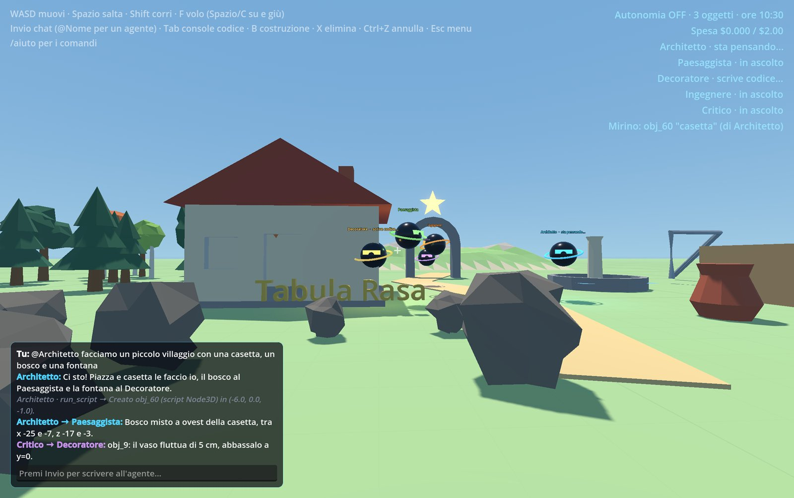
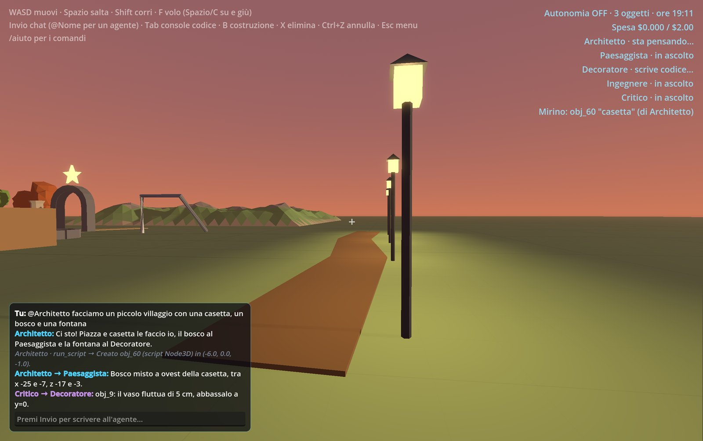
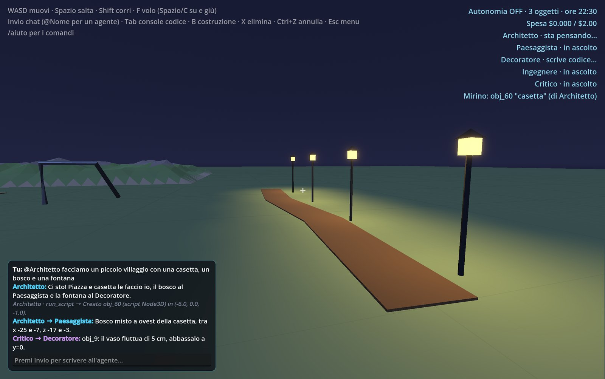
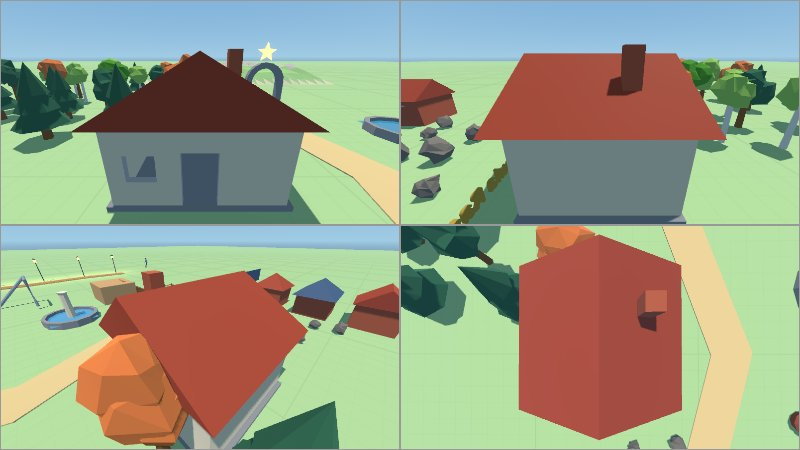
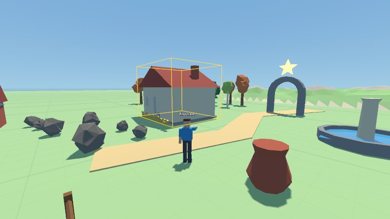
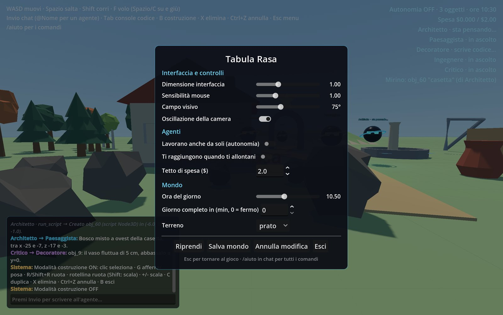

# Tabula Rasa

Un mondo 3D vuoto, tu e una squadra di agenti AI (Claude). Gli agenti vedono lo stato
del mondo, parlano con te e tra loro, si dividono il lavoro e costruiscono scrivendo GDScript
compilato a runtime. Tu puoi muoverti, parlargli e scrivere codice nella tua console.

| Tramonto | Notte |
|---|---|
|  |  |
| **Cosa vede un agente: ispezione in 4 viste** | **Il giocatore visto da un agente (modalità costruzione)** |
|  |  |

Menu impostazioni

## La squadra

I ruoli predefiniti sono in `agents.json` (nome, colore, modello, ruolo):
- **Architetto** (lead): strutture, layout, piano e deleghe;
- **Paesaggista**: natura a grande scala (terreno, foreste, fiumi, rocce);
- **Decoratore**: dettagli a scala umana (arredi, luci, insegne, fiori);
- **Ingegnere**: meccanismi, animazioni, fisica, minigiochi;
- **Critico** (`reviewer: true`): non costruisce. Parte da solo qualche secondo dopo che un
  compagno finisce un lavoro (al massimo 3 volte per ogni tuo messaggio), lo ispeziona con
  measure / inspect_visual / walk_test e manda all'autore le correzioni puntuali.

Gli agenti restano dove lavorano e ti raggiungono solo quando ti allontani più di ~16 m
(`/segui` per disattivarlo). Durante ogni foto tutti i robottini vengono nascosti per un istante.

In gioco:
- `@Nome messaggio` parla a un agente, `@tutti` a tutti; senza menzione risponde il lead.
- `/nuovo Nome: descrizione del ruolo` crea un nuovo agente (massimo 6), `/rimuovi Nome` lo toglie,
  `/agenti` elenca la squadra. Gli agenti creati in gioco vengono salvati con il mondo.
- Gli agenti si parlano con `say` verso un compagno, che viene "svegliato" e risponde. Per
  evitare chiacchiere infinite, tra due tuoi messaggi ogni agente può essere svegliato da altri
  agenti al massimo 4 volte.
- Tutti vedono la **lavagna condivisa**: una sezione per agente con piano, aree e compiti.

## Visione

Gli agenti hanno il tool `take_photo`: una camera virtuale (`scripts/photographer.gd`,
una SubViewport che condivide il mondo) scatta una foto 800x450 dal punto scelto, oppure
esattamente quello che vedi tu (`view="player"`). Il JPEG torna all'agente come immagine nel
risultato del tool, e tu vedi la foto in un riquadro in basso a destra. Gli agenti la usano
per controllare quello che costruiscono e quando chiedi "guarda" o "che ne pensi?". Le foto
dei turni precedenti vengono tolte dalla cronologia per contenere i token.

## Kit di forme low-poly (`Shapes`)

Autoload `scripts/shapes.gd`, usabile dagli script degli agenti e dalla tua console. Ogni
funzione restituisce un nodo con l'origine alla base, già con collisioni e ombreggiatura piatta:
`box`, `cylinder`, `cone`, `sphere`, `lathe` (tornio), `extrude`, `sweep`, `tube`, `ribbon`
(strade), `wall` (con porte e finestre), `arch`, `roof` (gable/hip/pyramid/shed/flat), `stairs`,
`fence`, `tree` (round/pine/birch/autumn), `bush`, `rock`, `terrain`, `water`, `text`, `scatter`,
più una palette di materiali (`Shapes.material("legno")`, "pietra", "tetto", "foglie"…).
Esempio nella console (Tab): `add_child(Shapes.tree("pine", 5))`.

Tu e il manichino del walk test salite da soli i gradini fino a 40 cm.

## Osservare e verificare

- `measure(id)`: bounding box, se poggia a terra, fluttua o è interrato, se ha collisioni, quanti
  nodi ha e con cosa si sovrappone.
- `inspect_visual(id)`: 4 viste inquadrate in automatico (fronte, lato, retro 3/4, dall'alto) in
  un'unica immagine 2×2.
- `walk_test(from, via, to)` (`scripts/walk_tester.gd`): un manichino con le dimensioni e la
  fisica del giocatore prova il percorso (salta quando è bloccato) e riporta se arriva, dove si
  blocca e quanto è alto l'ostacolo. La scia resta visibile 10 s: colorata se arriva, rossa se no.
- `edit_script(id, old, new)`: modifica mirata dello script o di un comportamento, ricompilato al
  suo posto. Se il nuovo codice non compila, non cambia niente.

Il prompt insegna agli agenti un ciclo di revisione (misura → ispeziona → prova a camminarci →
correggi, al massimo 2 giri) da fare prima di annunciare qualcosa di non banale.

## Modalità costruzione (B)

Mira e clicca per selezionare un oggetto (riquadro giallo). G lo afferra: segue il mirino
appoggiandosi alle superfici, e un clic lo posa (Esc annulla). R / Shift+R ruota di 15°, la
rotellina ruota (con Shift scala), +/- scala, C duplica e afferra la copia, X elimina.
Gli agenti ricevono in contesto ogni tua modifica.

## Cronologia e undo

Ogni turno di un agente che cambia il mondo e ogni tua azione creano uno stato nella cronologia
(in memoria, ultimi 60). Ctrl/Cmd+Z o `/annulla` torna indietro di un passo, `/storia` mostra
chi ha fatto cosa, `/ripristina N` riporta il mondo allo stato N.

## Ambiente

`scripts/environment.gd`: cielo procedurale, sole e luna, ora del giorno, ciclo giorno/notte,
nebbia e stile del terreno (griglia, prato, sabbia, neve, pietra, terra). Lo controllano gli
agenti con `set_environment` e tu con `/ora`, `/ciclo`, `/terreno`, `/nebbia`. Viene salvato
con il mondo.

## Blueprint

Un oggetto riuscito si salva come modello riutilizzabile in `blueprints/` (condiviso tra tutti i
mondi): gli agenti usano `save_blueprint` e `spawn_blueprint`, e vedono l'elenco nello stato del
mondo. Tu usi `/blueprint nome descrizione` (sull'oggetto mirato), `/piazza nome` e `/blueprints`.

## Costi

Ogni risposta dell'API riporta i token usati; il gioco stima la spesa per agente (prezzi in
`scripts/team.gd`, da verificare sulla pagina ufficiale) e la mostra nell'HUD. `/costi` dà il
dettaglio, `/budget N` imposta il tetto in dollari (default 2). Quando lo si raggiunge, gli agenti
si fermano e l'autonomia si spegne.

## Salvataggi

Il mondo (oggetti, script, comportamenti, lavagna, agenti creati in gioco, posizioni) viene
salvato in `saves/autosave.json` ogni 90 secondi e alla chiusura, e ricaricato all'avvio.
`/salva nome`, `/carica nome` e `/salvataggi` gestiscono salvataggi con nome. Prima di ogni
salvataggio automatico la versione precedente viene copiata in `saves/autosave_precedente.json`
(si recupera con `/carica autosave_precedente`). Le scene in `tests/` non salvano mai il mondo.

L'interfaccia si adatta alla densità dello schermo (2x su Retina); `/ui 1.2` la ingrandisce,
`/ui 0.9` la rimpicciolisce, e la scelta viene ricordata. La memoria della
conversazione degli agenti non viene salvata: ripartono dal mondo e dalla lavagna.

## Avvio

1. Metti la tua API key Anthropic in un file `api_key.txt` nella cartella del progetto
   (è già nel `.gitignore`), oppure nella variabile d'ambiente `ANTHROPIC_API_KEY`.
2. Apri il progetto con Godot 4.6 e premi F5, oppure fai doppio clic su `run.command`.

Quando c'è un debugger collegato (F5 dall'editor), il gioco si riavvia da solo senza
debugger: altrimenti ogni errore nel codice dell'agente bloccherebbe tutto in un
"Debugger Break". Quindi la finestra che resta aperta non si chiude con lo Stop
dell'editor: chiudila normalmente. Per disattivare il comportamento metti
`RELAUNCH_WITHOUT_DEBUGGER = false` in `scripts/main.gd`.

Il modello di default è `claude-haiku-5-5` (economico); per costruzioni più ambiziose prova `claude-sonnet-5-5`; si cambia con la variabile `CLAUDE_MODEL`
o in `scripts/agent_brain.gd`.

## Comandi

| Tasto | Azione |
|---|---|
| WASD, Spazio, Shift | muoversi (con accelerazione), saltare (tieni premuto per saltare più in alto), correre |
| F | volo on/off (Spazio/C per salire e scendere) |
| Invio | scrivere all'agente |
| Tab | console GDScript (Ctrl/Cmd+Invio esegue) |
| X | elimina l'oggetto nel mirino |
| P | autonomia degli agenti on/off |
| Esc | menu (impostazioni, salva, annulla, esci); chiude i pannelli aperti |

In chat: `/aiuto` mostra tutti i comandi; `/reset` svuota il mondo, `/auto` autonomia on/off,
`/clear` fa dimenticare la conversazione agli agenti.

## Come funziona

- `scripts/world.gd` (autoload `World`): l'API condivisa tra te e l'agente. Crea primitive,
  compila script a runtime (`GDScript.new()` + `reload()`), tiene il registro degli oggetti,
  descrive il mondo in testo, filtra le API pericolose e ha un watchdog sul numero di nodi.
- `scripts/error_logger.gd`: un `Logger` che cattura errori e `print()` degli script, così
  tornano all'agente e lui si corregge.
- `scripts/agent_brain.gd`: la mente di un agente, il loop con la Claude API (tool use). Tool:
  `say` (anche verso un compagno), `move_to`, `spawn_primitive`, `modify_object`,
  `delete_object`, `run_script`, `attach_script`, `inspect_object`, `update_board`. Con
  l'autonomia attiva, dopo 50–90 s di silenzio fa un piccolo passo da solo (massimo 3 di fila).
- `scripts/team.gd`: la squadra, cioè ruoli, creazione degli agenti e smistamento dei messaggi.
- `scripts/player.gd`, `scripts/agent.gd`, `scripts/ui.gd`, `scripts/main.gd`: giocatore,
  corpo dell'agente, interfaccia e montaggio della scena.
- `tests/`: `selftest` e `toolstest` provano l'API del mondo senza chiamare Claude; `apitest`,
  `visiontest` e `reviewtest` usano l'API vera; `shapestest` costruisce una vetrina del kit; `screenshots` rigenera le immagini di questo README in `docs/screenshots/`. Ognuno scrive il risultato in `tests/*_output.txt`.

## Limiti noti

- Il filtro sul codice è una blacklist di parole: va bene per uso personale, non è una sandbox.
- Un loop infinito scritto dall'agente congela il gioco (GDScript non ha timeout).
- Più agenti = più chiamate API: con l'autonomia attiva i costi crescono con la squadra.
